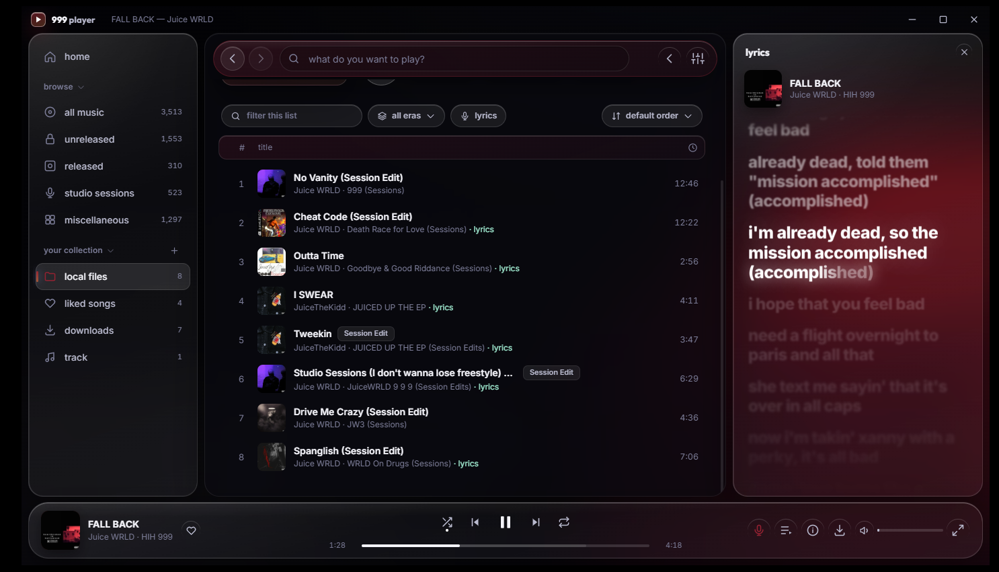
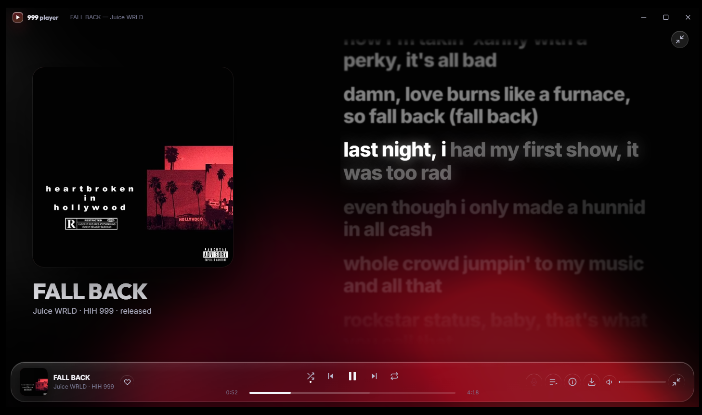
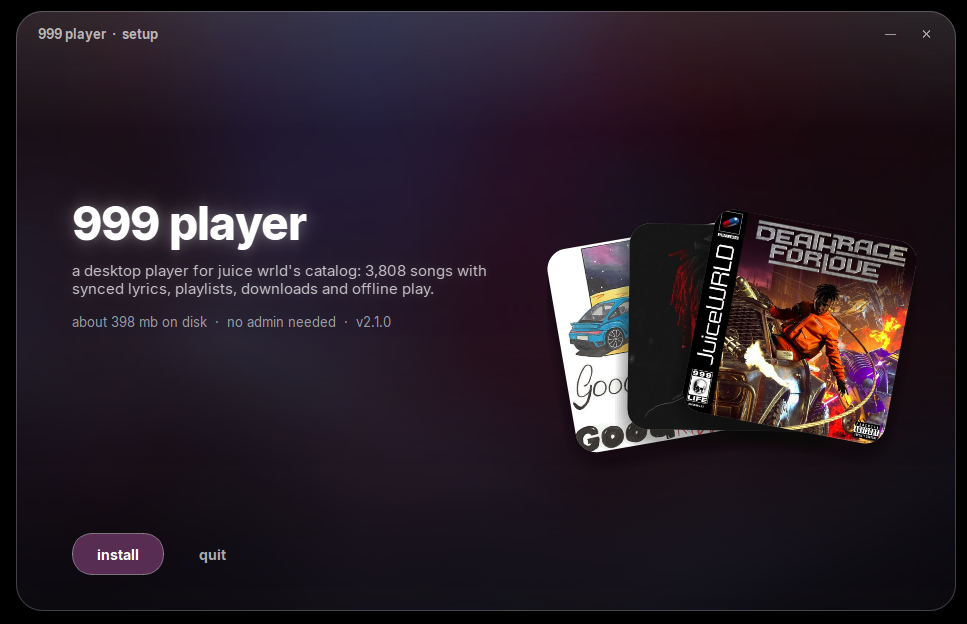

  

<h1 align="center">999 player</h1>

a free desktop player for the juice wrld vault. every song, synced lyrics, playlists, downloads, offline play.

  <a href="https://999player.com">999player.com</a>
  ·
  <a href="https://github.com/999player/999player/releases/latest">download for windows</a>
  ·
  <a href="https://discord.gg/yhK8zSH8T3">discord</a>

## what you get

- the full vault: released, unreleased, studio sessions. the catalog syncs every time you open the app.
- synced lyrics, word by word. they are stored inside the app so they work offline.
- playlists, likes and history, saved on your pc. no account.
- downloads with cover art and tags, playable without internet.
- local files: add your own folders and they show up next to the vault, with lyrics when the title matches.
- discord rich presence and last.fm scrobbling.
- updates install themselves.
- no ads, no tracking.

## install

1. download `999player-setup.exe` from the [latest release](https://github.com/999player/999player/releases/latest).
2. run it. no admin needed. default folder is `C:\999player`.
3. smartscreen will probably warn you because the exe is not signed. click "more info", then "run anyway".

don't want an installer? `999player-ptb.zip` is the same app as a folder. unzip it anywhere and run `999player.exe`. keep the `_internal` folder next to it.

windows 10 or 11, 64 bit. nothing else to install.

## iphone

there is an ios app too. it still needs sideloading, so it only goes out to testers on the [discord](https://discord.gg/yhK8zSH8T3) for now.

## keys

| | |
|---|---|
| play / pause | `space` |
| next / previous | `shift` + `→` / `←` |
| seek 5 s | `→` / `←` |
| volume | `↑` / `↓` |
| mute | `m` |
| lyrics panel | `l` |
| queue panel | `q` |
| now playing view | `f` |
| like | `h` |
| search | `ctrl` + `k` |
| shuffle / repeat | `s` / `r` |

## problems

- blank window, or it crashes every few minutes: usually the graphics driver. settings → appearance → gpu acceleration off, then restart. the app does this on its own after three crashes in a row.
- antivirus flags it: the exe is not signed, that is all it is seeing. tell it to leave the folder alone.
- anything else: the log is at `%localappdata%\999player\logs\app.log`. post it in the discord.

your likes, playlists and settings are in `%localappdata%\999player`. uninstalling keeps them unless you tick "wipe my data".

## source

the windows app and its installer live in [`src/`](src). python, pyside6 and a web ui. `src/HOW_TO_COMPILE.md` has the build steps.

## credits

all music and metadata come from [juicewrldvault.com](https://juicewrldvault.com). this is a fan project, not affiliated with grade a, interscope or the estate.
